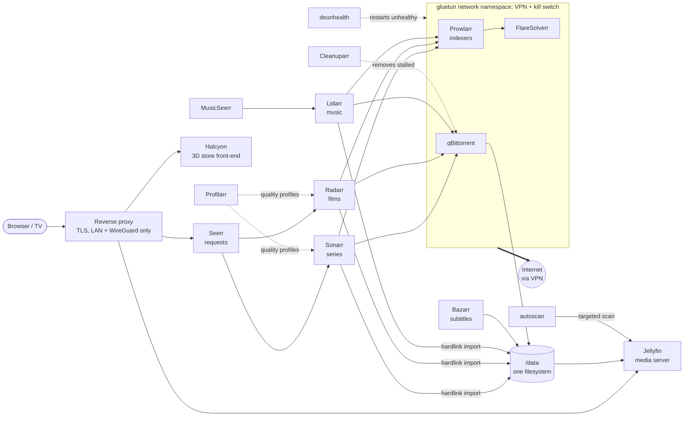

# Homelab media stack

[](https://github.com/0xKernelPanic/homelab-media-stack/actions/workflows/validate.yml)

A self-hosted media automation stack in a single Docker Compose file, running in my homelab on Proxmox. Sixteen containers request, find, download, organise, subtitle and serve films, series and music, with only the components that contact the outside world routed through a VPN tunnel with a kill switch.

## Architecture



## Design decisions

**Only what talks to the outside goes through the VPN.** qBittorrent, Prowlarr and FlareSolverr share [gluetun](https://github.com/qdm12/gluetun)'s network namespace (`network_mode: service:gluetun`), so they have no route to the internet except the tunnel: if the VPN drops, their traffic stops instead of leaking. Sonarr, Radarr and Lidarr never contact an indexer themselves (they go through Prowlarr), so routing them too would add failure modes without hiding anything. The trade-off is documented in the file: indexers see a shared VPN address, which means more Cloudflare challenges.

**FlareSolverr sits next to Prowlarr, not beside it.** Sharing the namespace means Cloudflare sees the same address solve the challenge and then use the cookie, which is what it checks for.

**Self-healing.** gluetun's own healthcheck reports the tunnel state, and dependent containers start only once it is healthy (`depends_on: condition: service_healthy`, `restart: true`). The containers behind the VPN probe connectivity themselves; when qBittorrent stalls after a reconnect its healthcheck fails and [deunhealth](https://github.com/qdm12/deunhealth) restarts it.

**One data root, hardlinks instead of copies.** Downloads and the library live under the same `DATA_DIR`, mounted at the same path in every container, so an import is an instant hardlink rather than a copy of a 40 GB file, and seeding continues from the same blocks. Jellyfin and MusicSeerr mount the library read-only.

**Reproducible versions.** Every image is pinned to a version (or to a digest where the project publishes no versions), and [Renovate](renovate.json) opens a pull request for each update, so an upgrade is a reviewed change with a changelog instead of a surprise on the next `pull`.

**No repetition.** Shared environment, restart policy, the VPN wiring and the probe are YAML anchors (`x-linuxserver-env`, `x-behind-vpn`, `x-vpn-probe`), so adding a service behind the VPN is one line.

**Hardware transcoding.** Jellyfin gets `/dev/dri` for Intel Quick Sync.

## Services

| Service | Role | Port |
|---|---|---|
| gluetun | VPN tunnel and kill switch | publishes 8080, 9696, 8191 |
| qBittorrent | download client (behind VPN) | 8080 |
| Prowlarr | indexer manager (behind VPN) | 9696 |
| FlareSolverr | Cloudflare challenge solver (behind VPN) | 8191 |
| Sonarr / Radarr / Lidarr | series / films / music | 8989 / 7878 / 8686 |
| Bazarr | subtitles | 6767 |
| Profilarr | quality profiles for Sonarr and Radarr | 6868 |
| Cleanuparr | removes stalled and failed downloads | 11011 |
| autoscan | targeted Jellyfin scans on import | 3468 |
| Jellyfin | media server, hardware transcoding | 8096 |
| Seerr / MusicSeerr | requests for films and series / music | 5055 / 8688 |
| Halcyon | the library as a walkable 1990s video store | 1420 |
| deunhealth | restarts containers whose healthcheck fails | none |

## Running it

```bash
cp .env.example .env     # set PUID/PGID, DATA_DIR and your VPN provider's keys
docker compose up -d
docker compose ps        # gluetun should turn "healthy" within a minute
```

Every container has a fixed address on `servarrnetwork` (172.39.0.0/24), because the apps store each other's URLs in their own settings and those must survive a container being recreated. The containers behind the VPN have no address of their own and answer on gluetun's:

| From | To | URL |
|---|---|---|
| Sonarr, Radarr, Lidarr | qBittorrent | `http://172.39.0.2:8080` (gluetun) |
| Sonarr, Radarr, Lidarr | Prowlarr | `http://172.39.0.2:9696` (gluetun) |
| Prowlarr | FlareSolverr | `http://localhost:8191` (same namespace) |
| Prowlarr | Sonarr, Radarr, Lidarr | `http://172.39.0.6:8989`, `.7:7878`, `.8:8686` |
| Seerr, autoscan | Jellyfin | `http://172.39.0.4:8096` |

To check that the tunnel really covers the containers behind it, both of these must print the VPN's address, not yours:

```bash
docker exec prowlarr curl -s https://ipinfo.io/ip
docker exec flaresolverr python -c "import urllib.request; print(urllib.request.urlopen('https://ipinfo.io/ip').read().decode())"
```

### Running in LXC (Proxmox)

gluetun needs the TUN device. In an unprivileged container add to `/etc/pve/lxc/<id>.conf` on the host:

```
lxc.cgroup2.devices.allow: c 10:200 rwm
lxc.mount.entry: /dev/net/tun dev/net/tun none bind,create=file
```

For Quick Sync, pass `/dev/dri` through the same way (`c 226:* rwm`) and map the `render` group.

### Halcyon Remote Play

The store renders in the browser, so it works from the bridge network. Remote Play (server-side rendering for phones and weak TV browsers) streams over WebRTC and has to advertise an address the client can reach, which from the bridge it cannot. For it, replace Halcyon's `ports` and `networks` with:

```yaml
    network_mode: host    # takes :1420, :3478/udp and 49200-49260/udp (TURN)
    devices:
      - /dev/dri:/dev/dri # GL and encoding for the headless Chromium
    shm_size: 1gb         # Chromium crashes with the default 64 MB /dev/shm
```

## Security notes

- No port of this stack is forwarded to the internet. The web interfaces are reachable only from the LAN or over WireGuard, behind a reverse proxy with TLS.
- The kill switch is gluetun's firewall: only `FIREWALL_OUTBOUND_SUBNETS` (the LAN and the stack's own network) are allowed outside the tunnel.
- `.env` holds the VPN keys and is never committed.
- deunhealth needs the Docker socket, which is root-equivalent on the host. It runs with no network at all (`network_mode: none`); a socket proxy limited to container restarts would narrow it further.

## Validation

Every push and pull request runs `docker compose config` against `.env.example` in [GitHub Actions](.github/workflows/validate.yml), so a broken anchor, an unset variable or a typo in a key fails the build before it reaches the server.

## License

[MIT](LICENSE). Use the stack for media you have the right to download.
